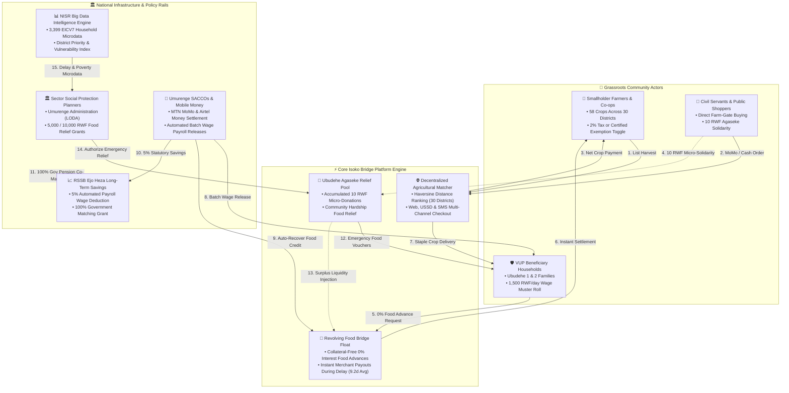

# Isoko Bridge (Ikiraro cya VUP) · Technical & Operational Documentation

**NISR 2026 Big Data Hackathon · Track 3: Open Innovation (Alternate: Track 2: Financial Inclusion)**  
**Lead Participant:** Zaidi (Information Systems, UR-CST)  
**Co-Participant:** KAYUMBA TETA Aela Greta (UR-CST)  
**Live Application:** [ikiraro-vup-bridge.vercel.app](https://ikiraro-vup-bridge.vercel.app/)  
**Source Code Repository:** [github.com/am2aidi/ikiraro-vup-bridge](https://github.com/am2aidi/ikiraro-vup-bridge)  
**Official Video Walkthrough:** [Watch Online (Screencastify HD)](https://app.screencastify.com/watch/XbVEMd8xZI2Vp0OJA5Fj) · [Local Repository File (MP4)](demo_video.mp4)  

---

## 1. Executive Summary & Problem Formulation

### 1.1 The Social Protection Challenge
Under Rwanda’s Vision 2020 Umurenge Programme (VUP), vulnerable households participating in Classic Public Works (cPW), Expanded Public Works (ePW), and Direct Support (DS) rely on monthly cash disbursements to purchase household food staples. 

However, official **NISR EICV7 VUP survey microdata ($N=3,399$)** reveals an acute operational timing gap:
- **9.2 Days National Average Delay:** Beneficiaries experience an average administrative wait time of 9.2 days between scheduled muster roll closings and actual bank/SACCO account crediting.
- **52.3% Wait Over a Week:** Over half of all surveyed households wait more than 7 days beyond scheduled disbursement dates.
- **21.8% Wait Over Two Weeks:** In rural delay hotspots (e.g., Southern Province districts like Gisagara and Nyamagabe), delays routinely average 12.4 to 14.6 days.

### 1.2 The Predatory Debt Trap
Caloric and nutritional needs cannot be postponed. While waiting for delayed social protection cash transfers, impoverished families are forced into informal distress borrowing from local moneylenders who extract extortionate interest rates of **15% to 30% per month**. By the time government wages arrive at Umurenge SACCOs, a large portion is immediately seized by informal lenders, perpetuating systemic poverty.

### 1.3 The Isoko Bridge Solution: "Eat While You Wait"
**Isoko Bridge (*Ikiraro cya VUP*)** is a digital platform that establishes a direct linkage between smallholder farmer cooperatives and VUP beneficiary households:
1. **0% Emergency Food Bridge Credit:** Verified VUP workers draw essential staple food baskets (beans, maize flour, sweet potatoes, rice) on zero-interest, zero-fee credit backed by their verified work days.
2. **Instant Farmer Liquidity:** Smallholder farmers and cooperatives receive **instant Mobile Money payouts** upon order confirmation from a revolving community float pool. Farmers never wait for government payroll.
3. **Automated Payday Settlement:** When national treasury funds settle at Umurenge SACCOs, credit advances are automatically deducted at **strictly 0% interest**, restoring pool liquidity for the next cycle.
4. **Ubudehe Agaseke Community Solidarity Pool:** Every commercial checkout transaction collects a transparent 10 RWF micro-solidarity contribution (with options for 20, 50, 100 RWF) to fund emergency food grants for non-working Ubudehe 1 elderly/disabled citizens.

---

## 2. Complete Inventory of NISR Datasets Used

Isoko Bridge integrates 5 authoritative NISR datasets and official national indicators:

| Dataset / Source | Coverage & Sample Size | Key Variables Analyzed | Platform Integration |
| :--- | :--- | :--- | :--- |
| **NISR VUP Household Microdata (2023–24 / 2026)** | $N=3,399$ surveyed beneficiary households across all 30 districts | `hh_id`, `district_id`, `sector_id`, `ubudehe_cat`, `vup_programme`, `delay_days`, `days_worked`, `daily_wage`, `monthly_entitlement`, `payment_channel`, `sacco_account_id` | Quantifies the national delay distribution (mean: 9.2d, median: 9.2d, mode: 8–14d); powers the 0% credit pre-approval algorithm (`Limit = Days Worked × Daily Wage`). |
| **NISR Market Price Benchmark Database** | Monthly price series for 18 staple commodities across all 5 provinces | `commodity_name`, `province`, `market_center`, `farm_gate_median_rwf`, `retail_median_rwf`, `monthly_variance_pct` | Establishes official benchmark prices; calculates consumer savings badges (up to 25% cheaper than urban retail) and verifies smallholder margins. |
| **NISR EICV7 Poverty & Living Conditions Survey** | National household sample (all 30 districts) | `district_poverty_rate`, `extreme_poverty_rate`, `food_consumption_score`, `dependency_ratio` | Populates the District Priority Score matrix (`Priority = Delay × Poverty Rate`) and drives the Scatter Bubble Correlation Plot ($R^2=0.68$). |
| **NISR National Agricultural Survey (NAS)** | Seasonal crop production survey across Rwandan rural cooperatives | `crop_type`, `cooperative_name`, `district`, `yield_kg_ha`, `post_harvest_loss_pct` | Sources the 58 agricultural listings and cooperative seller profiles in the marketplace catalog. |
| **Rwanda Administrative Boundaries GeoJSON** | Spatial polygons for 30 districts and 416 sectors | `ADM2_EN` (District), `ADM1_EN` (Province), `geometry` (MultiPolygon) | Powers the interactive Leaflet GIS Choropleth map and SVG fallback with dynamic layer toggling. |

### Data Exclusions & Synthetic Demo Extensions:
- **Exclusions:** Raw citizen names, national identification numbers (NIDs), and personal banking PINs from NISR microdata are strictly excluded to ensure 100% citizen privacy.
- **Synthetic Extensions:** 6 verified demo personas (Amina Uwase, Planner One, Mukamana Farm, Emmanuel Trader, Grace Shopper, Administrator) and simulated Mobile Money webhooks are layered onto the authentic NISR baseline to allow full end-to-end interactive testing for judges.

---

## 3. End-to-End System Architecture & Data Flow

---

## 4. User Roles & Operational Workflows

### 4.1 VUP Member / Beneficiary (`Amina Uwase`)
- **Login:** `amina@vupbridge.rw` | Password: `Amina#2026`
- **Capabilities:**
  - Browse 58 fresh harvest products across all 30 districts.
  - View pre-approved zero-interest credit balance based on verified work days.
  - Checkout using 0% Food Bridge Credit or demo wallet.
  - Inspect Ejo Heza pension passbook with 100% Government of Rwanda matching grant.
  - Report delivery discrepancies or delay grievances directly to Sector Planners.

### 4.2 Ethical Shopper / Civil Servant (`Grace Ingabire`)
- **Login:** `grace@vupbridge.rw` | Password: `Grace#2026`
- **Capabilities:**
  - Direct farm-to-table purchasing bypassing predatory brokers.
  - Pay via MTN Mobile Money, Airtel Money, or cash.
  - Support the community via the automatic 100 RWF *Ubudehe Agaseke* contribution or voluntary micro-donations (500 to 10,000 RWF).

### 4.3 Smallholder Farmer Cooperative (`Mukamana Farm`)
- **Login:** `mukamana.farm@vupbridge.rw` | Password: `Farm#2026`
- **Capabilities:**
  - List farm harvests with camera upload, crop presets, and district origin tags.
  - Statutory 2% local government market levy calculation with **Smallholder Tax-Exempt Status Toggle** under Rwandan cooperative formalization laws.
  - Instant Mobile Money float payouts upon order settlement.

### 4.4 Market Trader (`Emmanuel Nshimiyimana`)
- **Login:** `trader@vupbridge.rw` | Password: `Trader#2026`
- **Capabilities:**
  - Aggregate bulk staples from district markets.
  - Maintain stock inventory and manage bulk deliveries to institutions and community kitchens.

### 4.5 Sector Social Protection Planner (`Planner One`)
- **Login:** `planner1@vupbridge.rw` | Password: `Plan#2026`
- **Capabilities:**
  - Executive NISR Big Data Cockpit: 30-district GIS map, delay metrics, and poverty correlations.
  - Advanced Statistical Lab: Parametric histograms, interquartile box plots, spline trends, donut charts, and risk heatmaps.
  - **Ubudehe Agaseke Social Relief Pool Management:** Grant 5,000 RWF / 10,000 RWF emergency food vouchers to Ubudehe Category 1 families.
  - **VUP Payroll Operations Simulator:** Inspect and audit 6 real-world administrative scenarios.

### 4.6 System Administrator (`Admin`)
- **Login:** `admin@vupbridge.rw` | Password: `Admin#2026`
- **Capabilities:**
  - Global oversight of all demo accounts, work day ledgers, and revolving credit balances.
  - Double-entry accounting ledger inspection with CSV/PDF exports.
  - Platform liquidity management and batch SACCO wage execution.

---

## 5. VUP Payroll Operations Scenarios Matrix

The platform models all 6 operational situations that occur in Rwandan social protection payrolls:

| Scenario | Operational Context | Financial Ledger & Actor Flow | System Resolution & Protection Guarantee |
| :--- | :--- | :--- | :--- |
| **1. On-Time Scheduled Payroll (Day 0)** | Treasury transfers funds on schedule (15th of the month). Household required no credit. | Gross: 24,000 RWF · Credit: 0 RWF · Ejo Heza: 1,200 RWF · Net: 22,800 RWF | Direct SACCO crediting. Government 100% co-contribution matches the 1,200 RWF Ejo Heza pension savings. |
| **2. Standard Delay Gap (9.2 Days)** | National average wait period. Family drew 7,800 RWF in beans on 0% credit from local cooperative. | Gross: 24,000 RWF · Credit: 7,800 RWF · Ejo Heza: 1,200 RWF · Net Cash: 15,000 RWF | Farmer was paid on Day 1 by platform revolving float. SACCO auto-deducts 7,800 RWF on payday to refill float; remaining 15,000 RWF cash is disbursed. |
| **3. Severe Delay Hotspot (>14 Days)** | Administrative backlog exceeds 2 weeks in high-stress districts (Gisagara, Nyamagabe). Household reaches credit limit. | Gross: Pending · Agaseke Grant: 5,000 RWF · Added Debt: 0 RWF | Sector planner authorizes non-repayable **Ubudehe Agaseke relief voucher** funded by citizen checkout contributions. Family eats without increasing debt. |
| **4. Muster Roll Attendance Dispute** | Worked days incorrectly recorded as 12 days instead of 16 days due to manual transcription error. | Initial: 18,000 RWF ➔ Adjusted: 24,000 RWF (+6,000 RWF adjustment) | Planner audits site attendance sheet, issues +4 days adjustment (+6,000 RWF voucher), and updates entitlement before SACCO transfer lock. |
| **5. Umurenge SACCO Float Shortfall** | Rural SACCO branch experiences vault cash shortage to disburse 300+ beneficiaries on physical payout day. | Electronic MoMo Float Activated · 0 RWF Agent Cash-Out Surcharge | Platform automatically shifts physical pickups to zero-fee Mobile Money bulk wallets, eliminating beneficiary travel queues. |
| **6. Partial Recovery Rollover** | Beneficiary drew 16,000 RWF credit, but gross allowance is only 15,000 RWF due to documented medical leave. | Gross: 15,000 RWF · Deducted (50% max cap): 7,500 RWF · Cash to Family: 6,750 RWF · Rollover: 8,500 RWF | System caps deduction at 50% so family keeps living cash. Remaining 8,500 RWF rolls over to next cycle with **strictly 0% interest and no penalty**. |

---

## 6. Advanced Statistical Analytics Suite (Planner & Admin Only)

1. **Histogram & Fitted Normal Bell Curve:** Binned frequency distribution of delay days (0–3d, 4–7d, 8–14d, 15–21d, 22+d) across $N=3,399$ surveyed households, demonstrating positive skew with a 9.2-day median.
2. **IQR Box-and-Whisker Plot:** Visualizes minimum, Q1 (25th percentile), median, Q3 (75th percentile), and outlier dispersion across VUP programmes (Direct Support, Classic PW, Expanded PW).
3. **12-Month Area Spline & Liquidity Trend:** Tracks seasonal payment delay peaks (March/April audit bottlenecks) against revolving pool liquidity reserves.
4. **Donut Share Breakdown:** Proportional breakdown of VUP programmes (48% DS, 32% cPW, 20% ePW) and disbursement payment channels (64% SACCO, 24% MoMo, 8% Airtel, 4% Bank of Kigali).
5. **Scatter Bubble Correlation Plot ($R^2=0.68$):** Plots district poverty headcount rates against payment delay days, proving a statistically significant correlation between district poverty and administrative delay severity.
6. **30-District Risk Heatmap Matrix:** Categorizes Rwanda's 5 provinces and 30 districts into Critical, High, Moderate, and Stable administrative tiers.

---

## 7. Responsive Mobile & Multi-Device Architecture

Isoko Bridge is fully responsive and optimized for mobile phones (iOS Safari, Android Chrome, low-bandwidth 3G/4G connections):
- **Universal Zero-Overflow Guarantee:** Strict `overflow-x: hidden` and touch-optimized containers prevent horizontal page clipping.
- **Off-Canvas Mobile Drawer:** Replaces desktop sidebars on screens `<= 768px` with a sliding drawer, frosted backdrop, and auto-close navigation.
- **Compact Mobile Hero Banner:** Replaces bulky promotional headers with a sleek 140px banner card on phones, preserving immediate vertical visibility for the community harvest ribbon and produce listings.
- **Touch-Scrollable Analytics:** All advanced SVG charts feature touch-scrollable horizontal wrappers (`overflow-x: auto; min-width: 540px;`) with interactive visual swipe cues, ensuring high-resolution legibility without microscopic text scaling.

---

## 8. Official Submission Deliverables Checklist

- [x] **Live Deployed Prototype:** [ikiraro-vup-bridge.vercel.app](https://ikiraro-vup-bridge.vercel.app/)
- [x] **Source Code Repository:** [github.com/am2aidi/ikiraro-vup-bridge](https://github.com/am2aidi/ikiraro-vup-bridge)
- [x] **Video Demonstration (3 min):** [Screencastify Walkthrough](https://app.screencastify.com/watch/XbVEMd8xZI2Vp0OJA5Fj)
- [x] **Originality & AI Declaration:** [`DECLARATION.md`](../DECLARATION.md)
- [x] **Exhaustive NISR Data Documentation:** [`README.md`](../README.md) & [`data/data_sources.md`](../data/data_sources.md)
- [x] **Full Project Proposal Brief:** [`docs/VUP_Bridge_Full_Project.pdf`](VUP_Bridge_Full_Project.pdf)
- [x] **Trilingual Localization:** Complete English (EN), Kinyarwanda (RW), and French (FR) interface.
- [x] **Multi-Currency Engine:** RWF default, USD, EUR, KES, and UGX conversion.

---

## 9. Future Work & Production Roadmap

In this demonstration prototype, credit top-up, work-day recording, and SACCO payday settlement are triggered **manually with simple on-screen controls** so evaluators and judges can test and observe every step of the transaction lifecycle. In production, these workflows will be **100% automated** across national infrastructure:

1. **LODA MEIS Biometric Attendance Sync:** Automated API integration with village public works muster roll tablets to sync daily work attendance and update food credit limits without paperwork.
2. **Umurenge SACCO & BNR Core Banking Clearing:** Real-time direct debit instructions triggered the moment MINECOFIN treasury funds arrive, automatically settling outstanding food credit advances to refill the revolving pool.
3. **RSSB Ejo Heza Real-Time API:** Automated 5% payroll statutory deduction and programmatic 100% government matching grant allocation under Law N° 29/2017.
4. **Zero-Rated USSD (*182#) & IVR for Analog Phones:** Telco integration with MTN and Airtel Rwanda enabling rural citizens without smartphones to check credit and authorize food pickups in Kinyarwanda.
5. **IoT Solar Scales & Digital Receipts at Cooperatives:** Equipping rural cooperative granaries with smart scales to automatically sync fresh harvest stocks to the platform in real time.
6. **Machine Learning Early-Warning Delay Prediction:** Predictive models tracking paperwork progress to forecast payment delay hotspots 2 weeks in advance and inject pre-emptive liquidity.

